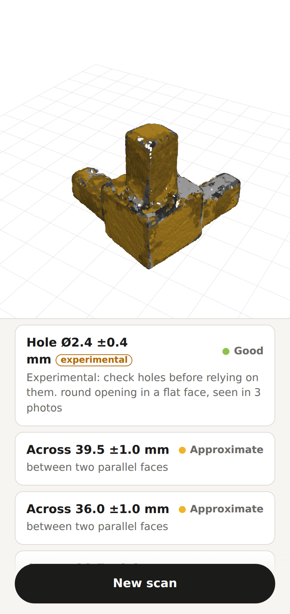
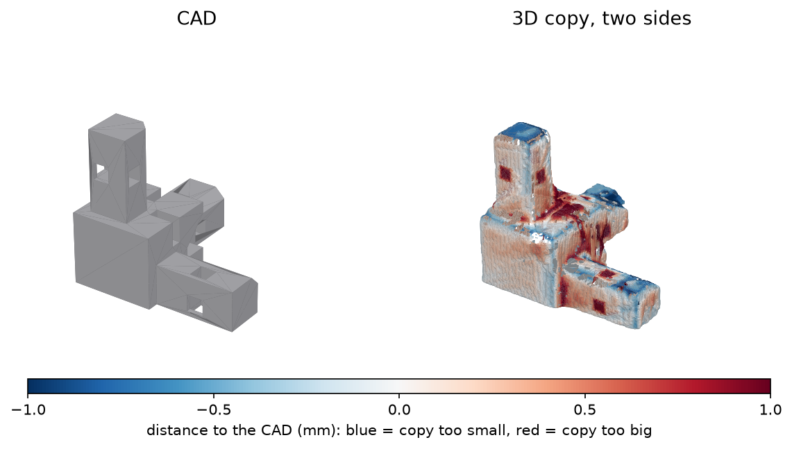

# ScanFit

*Experimental hobby software: read the [Disclaimer](#disclaimer-experimental-software-use-at-your-own-risk) before relying on results.*

**Measure a small part with your phone.** Stand it on a printed paper mat,
film it, and your own PC returns a to-scale 3D copy. You get its flat faces,
widths and heights, each with a ± value.

> *Picture to come: a phone filming a small black plastic part on the printed mat.*



Good for re-drawing a broken part in CAD, or designing something that fits
around it. The aim is errors under 1 mm: on the test parts, typical errors are
a few tenths of a millimetre, and 28 of 30 dimensions were within 1 mm.

Everything runs at home. The phone talks to your PC over your private network
(Tailscale). No cloud processing, no ScanFit account, no fees; Tailscale needs
a free account of its own.

## Quick start

First time, or on Windows? Follow [docs/getting-started.md](docs/getting-started.md):
it walks through WSL2, Docker, Tailscale, the mat and the phone step by step.
In short:

1. **Set up the PC.** Install Docker and Tailscale (on Windows: inside WSL2),
   then in a Linux terminal:
   ```sh
   git clone https://github.com/Fkroune/scanfit.git
   cd scanfit
   cp .env.example .env
   scripts/setup-check
   scripts/run-server
   ```
2. **Print the mat and measure its scale.** Print
   `web/static/scanfit-mat-a4.pdf` on A4 at 100 % ("actual size"). With a
   ruler, measure 10 squares in a row along the printed ring (150 mm when
   exact) and put the length in `.env` as `SCANFIT_MAT_10_SQUARES_MM`. Then
   run `scripts/run-server` again. Skipping this leaves your printer's 1–3 %
   scaling error in every result.
3. **Pair the phone and scan.** With the Tailscale app on, scan the QR code
   that `run-server` prints. The phone opens the app
   ([scanfit-app.pages.dev](https://scanfit-app.pages.dev)), already linked to your
   PC. Tap **Start scanning**, film the part all around, turn it over and film
   the other side.

## What you need

- An Android phone with Chrome.
- A PC with Linux, or Windows with WSL2, Docker and 8 GB of memory. An NVIDIA
  graphics card makes it faster; without one it still works, slower.
- An A4 printer and a ruler.
- About 25 minutes of PC time per side of the part (a normal scan has two
  sides).

## Results

Six real scans of two 3D-printed test parts with known CAD:
- a corner connector, 39.5 × 39.5 × 36.8 mm;
- a black jaw, 75 × 36 × 31.8 mm, with two Ø3.5 side holes.

Each 3D copy was fitted onto its CAD and compared (October 2026).

| Scan | Typical error | Surface within 1 mm | Dimensions within their ± | Within 1 mm |
|---|---|---|---|---|
| Corner, one side | 0.22 mm | 83 % | 3 of 4 | 4 of 4 |
| Corner, one side (2nd scan) | 0.21 mm | 82 % | 3 of 3 | 3 of 3 |
| Corner, both sides | 0.21 mm | 95 % | 8 of 9 | 9 of 9 |
| Corner, both sides (2nd scan) | 0.25 mm | 90 % | 7 of 8 | 8 of 8 |
| Black jaw, both sides, no torch | 0.38 mm | 92 % | 2 of 3 | 2 of 3 |
| Black jaw, both sides, torch | 0.42 mm | 82 % | 2 of 3 | 2 of 3 |

In total, 28 of 30 dimensions are within 1 mm of the CAD. Filming both sides of
the part gives the best results. Details: [docs/accuracy.md](docs/accuracy.md).



## Limits

- **Holes are experimental.** Real holes are found, but they often read about
  0.5 mm too small. Sometimes a hole is reported that is not there, and deep
  threaded holes can be missed. Check holes before you rely on them.
- **Sizes may read up to ~1.5 % large.** The shape is carved from the part's
  outlines, which can only err on the large side; on the test scans sizes read
  0.4–1.65 % large (1.5 % is 0.6 mm on a 40 mm part). Check critical sizes with a
  caliper. Fixing it is on the [roadmap](docs/dev/roadmap.md).
- **Openings are filled in the 3D copy.** Hole sizes come from the photos
  instead.
- **Quick scans may miss parts of the object.** A quick scan films one side
  only (for parts you cannot turn over). The camera never sees the underside,
  so parts of the object may be missing: its overall size is marked "may be
  incomplete" and gets no grade. Re-processing the same frames can also differ
  slightly. Normal scans film both sides.
- Inside corners come out rounded.
- The part must fit in the clear centre of the mat (about 11 × 11 cm).
- The phone app is tested on Chrome for Android only.

## Documentation

### Using ScanFit

- [Getting started](docs/getting-started.md): set up the PC, the mat and the phone.
- [Scanning guide](docs/scanning-guide.md): how to film for good results.
- [Reading the results](docs/reading-results.md): what the numbers and colours mean.
- [Accuracy](docs/accuracy.md): how it was tested, and how to test it yourself.
- [Troubleshooting and FAQ](docs/troubleshooting.md)
- [Privacy](PRIVACY.md) · [Changes](CHANGELOG.md)

### Contributing

- [Contributing](CONTRIBUTING.md): ways to help, development setup, tests, rules.
- [How it works](docs/dev/how-it-works.md): the steps from video to measurements.
- [Roadmap](docs/dev/roadmap.md): known problems and planned work.
- [Benchmark](docs/dev/BENCHMARK.md): the real-capture benchmark and other scanning tools.
- [Security](SECURITY.md): how to report a vulnerability.

## Disclaimer: experimental software, use at your own risk

ScanFit is a free hobby project, shared for experimental and informational purposes. It is provided "as is" and "as available", without warranties of any kind, to the fullest extent permitted by applicable law. Sections 7 and 8 of the [Apache License 2.0](LICENSE) apply; this notice summarises them and does not replace them.

- **Results can be wrong.** ScanFit may fail, or produce incomplete or inaccurate 3D copies, measurements or STL files. Its ± values are estimates, not calibrated or certified measurements. ScanFit is not a measuring instrument.
- **Verify before you rely on it.** Check critical dimensions with a suitable measuring tool before printing, machining or fitting a part. Do not use ScanFit outputs for safety-critical, medical, load-bearing, vehicle or other high-risk applications without appropriate independent validation.
- **Your computer, your network, your data.** You run ScanFit's server on your own computer and network and are responsible for securing them. The software may contain defects or vulnerabilities and may cause loss, corruption or unintended disclosure of data. Keep independent backups of anything important. See [PRIVACY.md](PRIVACY.md) for where data goes.
- **No support obligation.** The authors and contributors do not commit to maintenance, support, security updates, error correction, or availability of the hosted phone app.
- **Third-party components and services** (such as COLMAP, SAM 2.1, OpenCV, Open3D, ONNX Runtime, Docker, Tailscale and Cloudflare) are governed by their own licences and terms; see [THIRD_PARTY.md](THIRD_PARTY.md). ScanFit is not affiliated with or endorsed by their owners.

To the fullest extent permitted by applicable law, the authors and contributors are not liable for damages arising from the use of, inability to use, or reliance on ScanFit or its outputs, including data loss or corruption, damage to equipment or parts, financial loss and consequential damages.

Nothing in this notice excludes or limits any liability, warranty or right that cannot lawfully be excluded or limited, such as liability for intent or gross negligence, or for injury to life, body or health where applicable law provides for it.

By using ScanFit, you acknowledge that it is experimental and that you are responsible for judging whether it suits your intended use.

## Licence

Apache-2.0 (see `LICENSE`). Third-party parts and their licences:
[THIRD_PARTY.md](THIRD_PARTY.md). The test parts (the test block, the corner
connector and the black jaw) and their STL files are ScanFit's own designs,
under the same Apache-2.0 licence.
