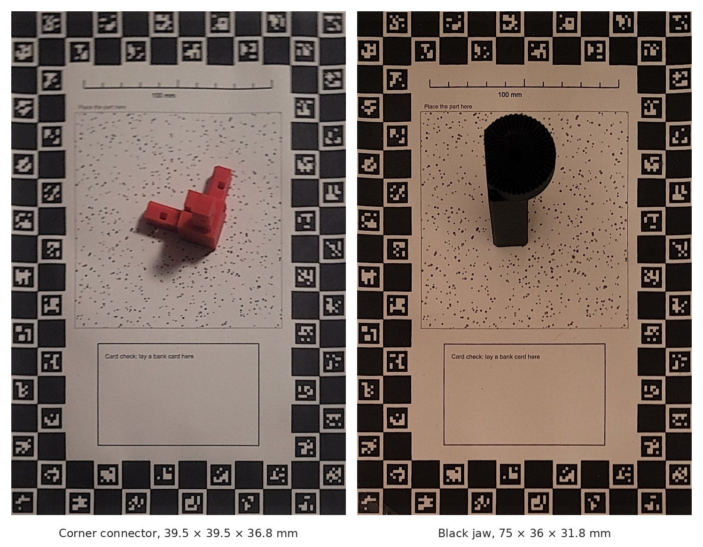
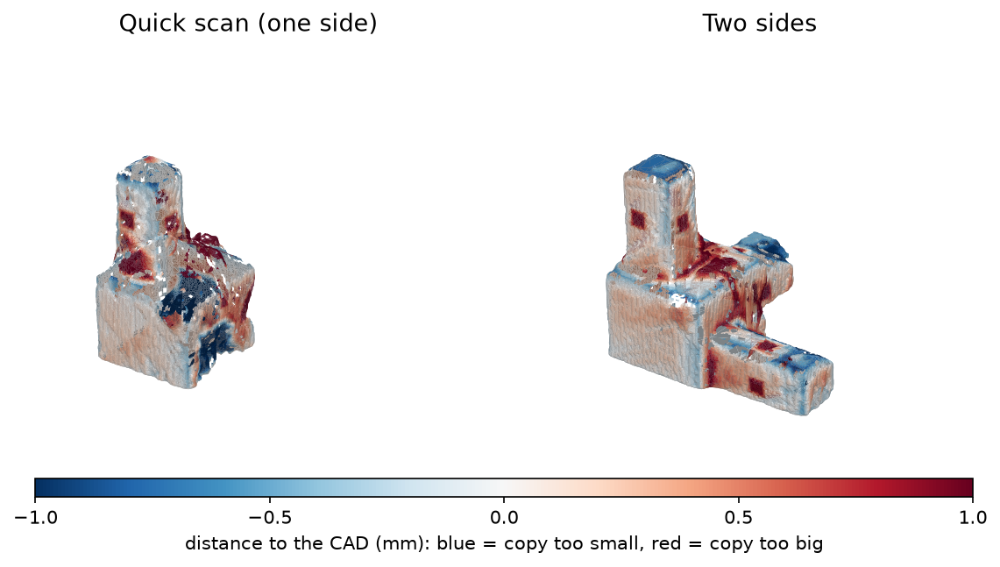

# Accuracy

## How ScanFit was tested

Two 3D-printed parts with known CAD were scanned with an Android phone, and
processed on a laptop (8 GB for WSL2, an entry-level NVIDIA GPU (2 GB)):
- a **corner connector**, 39.5 × 39.5 × 36.8 mm, with square 9.6 mm arms and
  small square windows;
- a **black jaw**, 75 × 36 × 31.8 mm, with two Ø3.5 side holes and a threaded
  Ø6.5 top hole.



For each scan, the 3D copy was fitted onto the CAD by shape alone (rotation and
position, no scaling, so size errors stay visible). Then:
- **typical error**: the median distance from the copy's surface to the CAD;
- **surface within 1 mm**: the share of the copy within 1 mm of the CAD;
- **dimensions**: each measured width, height or hole was compared with the
  same measurement taken on the CAD.

## Results (October 2026)

| Scan | Typical error | Surface within 1 mm | Dimensions within their ± | Within 1 mm | Holes |
|---|---|---|---|---|---|
| Corner, one side | 0.22 mm | 83 % | 3 of 4 | 4 of 4 | none (correct) |
| Corner, one side (2nd scan) | 0.21 mm | 82 % | 3 of 3 | 3 of 3 | none (correct) |
| Corner, both sides | 0.21 mm | 95 % | 8 of 9 | 9 of 9 | one false hole |
| Corner, both sides (2nd scan) | 0.25 mm | 90 % | 7 of 8 | 8 of 8 | none (correct) |
| Jaw, both sides, no torch | 0.38 mm | 92 % | 2 of 3 | 2 of 3 | threaded hole missed |
| Jaw, both sides, torch | 0.42 mm | 82 % | 2 of 3 | 2 of 3 | 2 real side holes (Ø3.11, Ø2.80 vs 3.5), one false hole, threaded hole missed |

- ScanFit's bar is an error under **1 mm**: 28 of 30 dimensions were within
  1 mm of the CAD; 25 of 30 within their own ±.
- Two-sided scans give the most complete surface.
- An automated test scans a synthetic 40 × 30 × 20 mm block with a Ø10 hole and
  must measure it within ±0.5 mm.



## Known weaknesses

- **Holes** (experimental): real side holes read 0.4–0.7 mm small. False holes
  appeared on two scans. A threaded hole inside a shallow recess was missed.
- **Repeatability**: processing the same frames twice gives slightly different
  camera positions (median 0.14 mm). On one one-sided scan, a fresh solve kept
  only one arm of the part.
- **Sizes read large**: on every test scan, the scale came out 0.4–1.65 %
  large, so sizes may read up to ~1.5 % large. The shape is carved from the
  part's outlines (shape from outlines), which can only err outwards. See the
  [roadmap](dev/roadmap.md), item 2: help with caliper-checked prints is welcome.
- **Quick scans** (one side filmed) may miss parts of the object: the camera
  never sees the underside.
- **Printer scale**: if you skip the mat measurement, every result carries your
  printer's scaling error (often 1–3 %).

## Test it yourself

### With the synthetic block (no printer needed)

```sh
cd worker
python -m pytest            # renders 64 views of the block, scans and measures it (~6 min)
```

The block is described in `artefacts/test_block.scad`.

### With your own part

You need a part with a known size: a CAD model (STL) of a 3D-printed part, or
a part you can measure with a caliper. The corner connector from these tests
(`scanfit-corner-connector.stl`) and the test block (`scanfit-test-block.stl`)
are attached to each [release](https://github.com/Fkroune/scanfit/releases).

1. Scan it (see the [scanning guide](scanning-guide.md)).
2. Download the 3D copy: the job's `result/mesh.ply` on the server.
3. Compare it with the CAD:
   ```sh
   cd worker
   python -m scanfit_worker.compare mesh.ply part.stl --save aligned.ply
   ```
   This prints the scale error, the median distance and the coverage. Open
   `aligned.ply` together with the STL in a viewer (MeshLab, CloudCompare) to
   see where they differ.
4. For single dimensions, compare the measurement list with your CAD or your
   caliper.

Please share your results (part, material, colour, one or two sides, numbers)
in an issue: it helps everyone.
