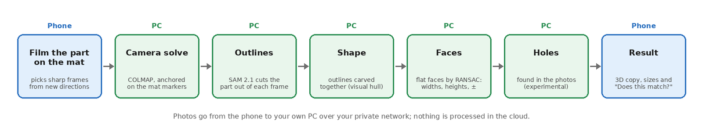

# How it works

From a few minutes of phone video to measurements in millimetres, in seven
steps. The parameters of each step are in the code under `worker/scanfit_worker/`.

## 1. The mat gives scale and position

The A4 mat carries a ring of ChArUco markers: chessboard squares with coded
patterns. Each marker has a known position in millimetres. In every photo where
enough markers are visible, ScanFit knows exactly where the camera was.

## 2. The phone picks good frames

The app reads the markers live (OpenCV in the browser). It keeps a frame only
if it is sharp, well lit, and from a direction not yet filmed. The phone's
motion sensors track the direction between marker sightings, so close-ups
without the mat still count. A dome on the screen shows what is missing.

## 3. Camera solve

On the PC, COLMAP (an open-source photogrammetry tool) matches features
between the frames and places every camera, including close-ups where the mat
is not visible. A bundle adjustment anchored on the markers keeps everything in
true millimetres. A small bend model handles paper that is not perfectly flat.

## 4. Outlines

SAM 2.1 (Meta's "Segment Anything" model) cuts the part out of each frame. It
is told where to look by the 3D scene: the part's box and some of its own
points, plus some paper points that are not part. It works on plain, black and
shiny plastic, where simple colour rules fail.

## 5. Shape

All outlines are carved together: space that any two views see as "not the
part" is removed. What is left is the part's shape (a "visual hull"). It does
not need any surface texture. Where the part has texture, COLMAP's dense stereo
adds detail. Because two views are enough to remove space, a few outlines that
leave out a piece (an arm, a tab) remove it: lumps of dense points that most
outlines keep but the carved shape lost are found, and the photos that cut them
away are outlined again with clicks inside the lump. When both sides were
filmed, the two halves are aligned by their shape and carved together.

## 6. Measurements

Flat faces are found with RANSAC, a robust fitting method. Two parallel faces
that face each other give a width; a flat top gives a height. Each value gets a
± from how well its faces fit, the scale uncertainty, and a small allowance for
systematic errors.

## 7. Holes (experimental)

Each face is unwarped from the photos into a to-scale picture of that face.
Standard circle detectors (EDCircles, MSER) propose round openings. Each one is
then measured in every photo separately, and kept only when the photos agree
on its size, it is round, and it has depth. The spread between photos gives
its ±.

## What runs where

| Where | What |
|---|---|
| Phone (browser) | Capture, frame choice, upload, live progress, 3D viewer |
| PC (Docker) | Server (FastAPI) and worker: COLMAP, SAM 2.1 (ONNX Runtime, CPU), Open3D, OpenCV |
| Internet | Only to load the phone app's web page. Photos and results stay on your network |
