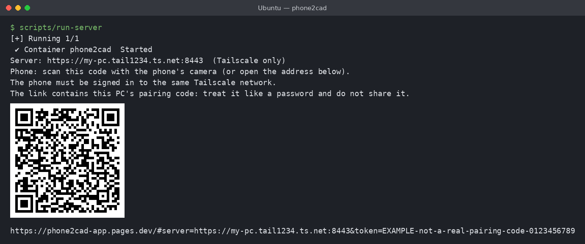
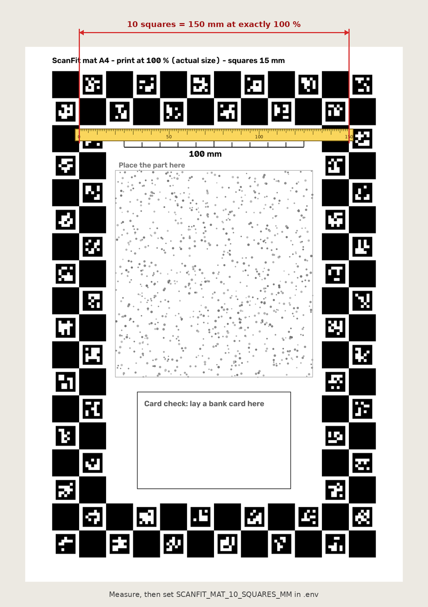

# Getting started

This guide sets up three things: the PC that does the work, the printed mat,
and the phone. Plan about an hour the first time (most of it is waiting for
downloads).

You need:
- a PC with **Windows 10/11** (with WSL2, set up below) or **Linux**;
- **8 GB of memory** for Linux / WSL2, and about **20 GB of free disk**;
- optional: an NVIDIA graphics card, for faster processing;
- an **Android phone with Chrome**;
- an **A4 printer** and a **ruler** with millimetres.

On Linux, skip step 1 and run the commands in any terminal.

## 1. Windows only: WSL2 and Ubuntu

Phone2CAD runs on Linux. On Windows it runs inside **WSL2** (Windows Subsystem
for Linux), a small Linux system that comes with Windows.

1. Right-click the Start button, choose **Terminal (Admin)** (or **Windows
   PowerShell (Admin)**), and run:
   ```powershell
   wsl --install -d Ubuntu
   ```
2. Restart the PC when asked. After the restart an **Ubuntu** window opens:
   choose a user name and a password (the password is asked again by `sudo`).
3. From now on, every command in this guide is typed in that **Ubuntu**
   window (Start menu → Ubuntu), not in PowerShell.
4. Give WSL2 enough memory. In Windows, open `%UserProfile%` in File Explorer
   (type it in the address bar), create a file named `.wslconfig` with this
   content, then run `wsl --shutdown` in PowerShell and open Ubuntu again:
   ```ini
   [wsl2]
   memory=8GB
   ```
   On a PC with 8 GB in total, use `memory=6GB` and close other heavy programs
   while a scan is processed.

## 2. Docker

Phone2CAD's server runs inside **Docker**, which packs it with everything it
needs (COLMAP, the outline model, Python) so you install nothing else by hand.

- **Windows**: install [Docker Desktop](https://www.docker.com/products/docker-desktop/).
  Open it, go to **Settings → Resources → WSL integration**, switch on
  **Ubuntu**, and click **Apply & restart**. Docker Desktop must be running
  whenever you use Phone2CAD. With an NVIDIA card, keep its Windows driver up to
  date: Docker Desktop then uses the card without anything else to install.
- **Linux**: install [Docker Engine](https://docs.docker.com/engine/install/)
  with the Compose plugin, then add yourself to the `docker` group
  (`sudo usermod -aG docker $USER`) and log out and back in. With an NVIDIA
  card, also install the
  [NVIDIA Container Toolkit](https://docs.nvidia.com/datacenter/cloud-native/container-toolkit/latest/install-guide.html).

Check in the Ubuntu window (or Linux terminal): `docker run --rm hello-world`
prints "Hello from Docker!".

## 3. Get Phone2CAD

In the Ubuntu window:

```sh
sudo apt update && sudo apt install -y git qrencode
cd ~
git clone https://github.com/Fkroune/phone2cad.git
cd phone2cad
cp .env.example .env
```

`qrencode` draws the pairing QR code in the terminal when the server starts
(step 5). Keep the folder in
your Ubuntu home (`~`), not in a Windows folder (`/mnt/c/…`): your scans are
stored in it (`data/server/`), and on a Windows drive Linux file permissions do
not apply, so any Windows program (and backup or sync tools) could read them.
It is also faster. `run-server` warns if the data folder is on a Windows drive.

`.env` is your settings file. Open it with `nano .env` (save: Ctrl+O, Enter;
quit: Ctrl+X). You will fill in one value in step 6; the rest can stay as it is.

## 4. Private network: Tailscale

The phone must reach the PC over HTTPS: phone browsers only allow the camera
and local connections on secure pages. The simplest way is
[Tailscale](https://tailscale.com): a free private network between your own
devices (your "tailnet"). Nothing is opened to the internet.

1. Install Tailscale on the PC, in the Ubuntu window (on Windows, inside WSL2:
   not the Windows app), following
   [Tailscale's Linux instructions](https://tailscale.com/download/linux) (they
   add Tailscale's package repository, so it updates with `apt`). Then:
   ```sh
   sudo tailscale up
   ```
   Open the link it prints and sign in (a free personal account is enough).
2. Install the **Tailscale** app on the phone (Play Store) and sign in with the
   **same account**. Leave it switched on while you scan.
3. Open the [DNS page of the Tailscale admin console](https://login.tailscale.com/admin/dns)
   and switch on:
   - **MagicDNS**: gives the PC a name such as `my-pc.tail1234.ts.net`;
   - **HTTPS Certificates**: lets the PC get a real certificate for that name.

   **Certificates are public.** Every HTTPS certificate is recorded in public
   Certificate Transparency logs, so the PC's name and your tailnet's name
   (such as `my-pc.tail1234.ts.net`) become publicly visible, for good. Before
   the first start, give the PC a neutral name (not your own name):
   `sudo tailscale set --hostname=phone2cad-pc`, and keep the random tailnet name
   Tailscale chose.
4. Once, on the PC: `sudo tailscale set --operator=$USER`. This lets your user
   control Tailscale on this PC without `sudo`, so `run-server` can fetch the
   certificate.

Only devices in your tailnet can reach the server, and only a phone that
opened the pairing link (step 7) can use it. Nothing is opened to the internet.
See [who can reach the server](#who-can-reach-the-server) if other people or
shared devices are in your tailnet.

> *Picture to come: the Tailscale admin DNS page with MagicDNS and HTTPS Certificates switched on.*

**Without Tailscale: not supported.** The phone app only connects to
Tailscale (`*.ts.net`) addresses, and `run-server` always binds the server to
the PC's Tailscale address. Do not work around this by binding the server to
all interfaces, forwarding its port on your router, or using Tailscale Funnel:
that would put it on your LAN or the internet.

## 5. Check and start

In the `phone2cad` folder:

```sh
scripts/setup-check
```

Each line says **PASS**, **WARN** (works, not ideal) or **FAIL** (fix it
first). The fix is written on the line; more help in
[troubleshooting](troubleshooting.md). A WARN about the mat scale is expected
until step 6. Then start the server:

```sh
scripts/run-server
```

The first start builds the server image. This takes 10–20 minutes and
downloads, once, the outline model (SAM 2.1, Meta's "Segment Anything" model,
about 110 MB, from Hugging Face; a fixed version, checked against its
checksum), which finds the part's outline in each photo. The finished image
takes about 12 GB of disk. Later starts take seconds.

At the end, `run-server` prints the server's private address and a QR code, in
the same terminal window, just above the long pairing link. The QR code needs
`qrencode` (installed in step 3; `scripts/setup-check` warns if it is missing).
Without it, only the link is printed: install it with `sudo apt install
qrencode`, run `scripts/run-server` again, or type the link into the phone's
browser by hand. The first start also creates the PC's **pairing code** (in
`~/.config/phone2cad/token`, readable only by you); the QR code and the link
below it contain it. Treat that link like a password: anyone in your tailnet
who has it can send scans to your PC and read your results.



## 6. The mat

The mat is a printed A4 sheet. Its markers tell Phone2CAD where each photo was
taken from, and how big a millimetre is.

1. Print `web/static/phone2cad-mat-a4.pdf` on plain white A4 paper. On Windows,
   `explorer.exe web/static` (in the `phone2cad` folder) opens that folder in
   File Explorer; the phone app's home page also has a download link. In the
   print dialog choose **100 %** or **Actual size**, never "Fit to page".
2. Lay it flat on a table. Tape the corners if the paper curls.
3. **Measure the mat scale.** Lay a ruler along one straight side of the
   printed ring and measure the length of **10 squares in a row** (black and
   white squares both count), in millimetres. At exactly 100 % they measure
   150 mm.
4. Put that length in `.env`, for example `PHONE2CAD_MAT_10_SQUARES_MM=149.5`,
   and run `scripts/run-server` again.

Do not skip step 3. Printers often scale a page by 1–3 %, and every
measurement scales with it: a 3 mm error on 150 mm means 2 % on every result.



## 7. The phone

1. Check that the Tailscale app is on.
2. Scan the QR code from `run-server` with the phone's camera. It opens the
   phone app in Chrome (https://phone2cad-app.pages.dev). The app shows the PC's
   name (for example **my-pc**) and asks whether to pair with it: check that it
   is your PC, then tap **Pair**. A pairing link never switches the phone to
   another PC without asking.
3. If Chrome asks to let the page reach devices on your network, tap
   **Allow**: this is how the photos go straight to your PC. Allow the camera
   too when asked.
4. To add the app to your home screen: Chrome menu (⋮), then **Add to home
   screen**.

If you cannot scan the code, open the app and paste the whole link printed
below it (it ends with `&token=…`). The address alone is not enough.

**New phone, lost phone, or link shared by mistake?** Run
`scripts/run-server --new-token`: it makes a new pairing code, and phones
paired with the old one get "not paired" until they scan the new QR code. To
unpair a phone yourself, tap **Forget this PC** in the app.

## Who can reach the server

Tailscale decides which devices can connect to the PC; the pairing code
decides which of them may use Phone2CAD. If your tailnet has other people (family
or team members) or devices you do not fully trust:

- limit who can reach port 8443 of the PC in the
  [access controls](https://login.tailscale.com/admin/acls) of your tailnet,
  for example a grant that allows only your own phone:
  ```json
  {"grants": [{"src": ["your-name@example.com"], "dst": ["tag:phone2cad"], "ip": ["tcp:8443"]}]}
  ```
  (tag the PC `tag:phone2cad` in the admin console, and remove the default
  "allow all" rule if you keep one);
- do not share the PC with other tailnets (node sharing), and turn on device
  approval so new devices need your OK;
- never enable Funnel for the PC: it would publish the server on the internet;
- **on native Linux** (not Windows with WSL2, which is the tested setup),
  Docker's own firewall rules can bypass `ufw` and similar tools. `run-server`
  publishes the port on the PC's Tailscale address only, but to be sure that
  devices on your local network cannot reach it either, add a rule such as
  `sudo iptables -I DOCKER-USER ! -i tailscale0 -p tcp --dport 8443 -j DROP`
  (it matches the container's port; make it permanent with your firewall
  tooling, since it does not survive a reboot). Assumes Tailscale's standard
  interface tailscale0 (not userspace-networking mode); the rule matches the
  container port 8443 even if PHONE2CAD_PORT is changed. We have not tested this
  on native Linux; please report what you find.

Next: [the scanning guide](scanning-guide.md).

## Optional: a prebuilt server image

To skip the 10–20 minute build, put `PHONE2CAD_IMAGE=ghcr.io/fkroune/phone2cad:1.1.0`
in `.env`: `run-server` then downloads the image built for each release.

## Optional: host your own copy of the phone app

The phone app is a static website. `scripts/deploy-web` builds it and publishes
it to Cloudflare Pages (free plan). It needs Node.js 20 or newer; run
`npm ci && npx --no-install wrangler login` in `web/` once (the wrangler version
is pinned in `web/package-lock.json`). It deploys only committed code, and
before uploading it checks every file for local paths, user and machine names,
tailnet addresses, e-mail addresses and keys (`scripts/privacy-scan`).
Then put your app's address in `.env` as `PHONE2CAD_APP_URL`. Without it, `run-server`
uses the public app at https://phone2cad-app.pages.dev.
