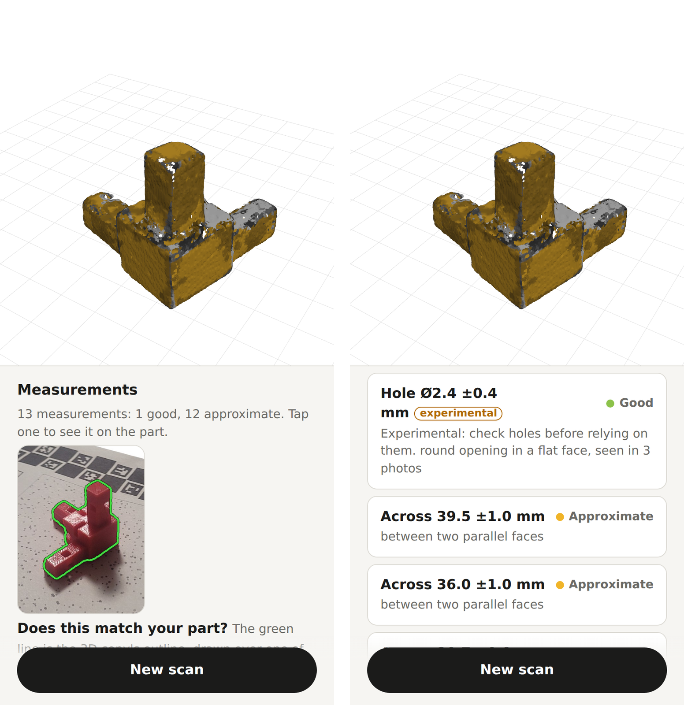

# Reading the results

quot;Does this match your part?quot; photo; right, scrolled to the measurement list">

## The 3D copy

Turn it with one finger, zoom with two. Its colours show how sure ScanFit is
about each face:

| Colour | Grade | ± |
|---|---|---|
| Green | Precise | up to 0.3 mm |
| Light green | Good | up to 0.6 mm |
| Amber | Approximate | up to 1 mm |
| Red | Rough | over 1 mm |
| Grey | not measured | — |

The 3D copy is a guide, not a precise model. Openings (holes, windows) are
filled in it, and inside corners are rounded. Use the measurements for numbers.

## The measurements

Each line is one measurement with its ± value, for example
`Across 20.2 ±0.9 mm`.

- **Across**: the distance between two parallel faces that face each other (a
  width or a thickness).
- **Gap**: the distance between two parallel faces that face away from each
  other (for example, the space between two arms).
- **Height**: the height of a flat top face above the table.
- **Hole / Boss**: the diameter of a round hole or a round pin.
- **Hole to hole**: the distance between the centres of two holes on one face.
- **Overall**: the size of the box around the part. It is rough: use it as a
  check, not a measurement. It has no grade. On a quick scan (one side
  filmed) it is marked **may be incomplete**: parts of the object may be
  missing from the 3D copy.

Tap a measurement to see it on the 3D copy: the faces it uses are outlined, and
the span is drawn.

## "Does this match your part?"

Above the measurement list, the page shows one of your own photos with the 3D
copy's outline drawn over it in green. If the line misses a part of the object
(an arm, a tab) or wraps around something that is not the part, the scan went
wrong: film again. On a two-sided scan the result usually also warns that the
two sides' shapes do not match well.

## What ± means

The ± is a 95 % range from the measurement's own fit. A width of
`20.2 ±0.9 mm` means the true width is very likely between 19.3 and 21.1 mm. On
the test parts, most measured values fell inside their ± (see
[accuracy](accuracy.md)).

The ± does not include one known bias: **sizes may read up to ~1.5 % large**,
because the shape is carved from outlines, which can only err on the large
side (0.4–1.65 % on the test scans). ScanFit's aim is errors under 1 mm; on a
40 mm part, 1.5 % is 0.6 mm.

## "Experimental"

All hole results carry an **experimental** tag in this version. Holes often read
about 0.5 mm small, and a hole may be reported that is not there. Check holes on
the part before you rely on them.

## Notes for your next scan

At the bottom, the page lists anything that went less well: too few low
angles, unclear outlines, a rough lens fit. Each note says what to do next time.

## Using the numbers in CAD

- Round to the precision you trust: a ±0.9 mm value is good to about 1 mm.
- Prefer measurements from two-sided scans.
- For a part that must fit, check the critical sizes with a caliper.
