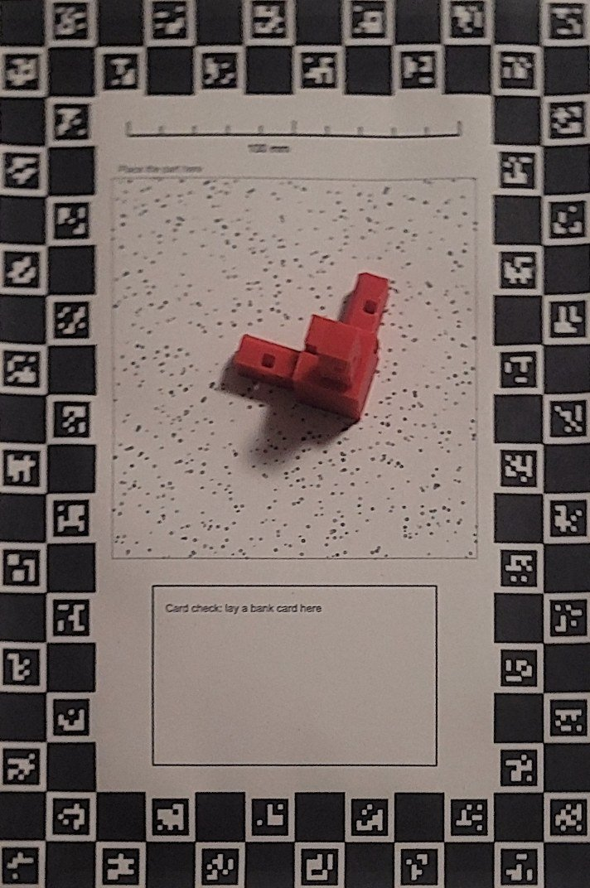
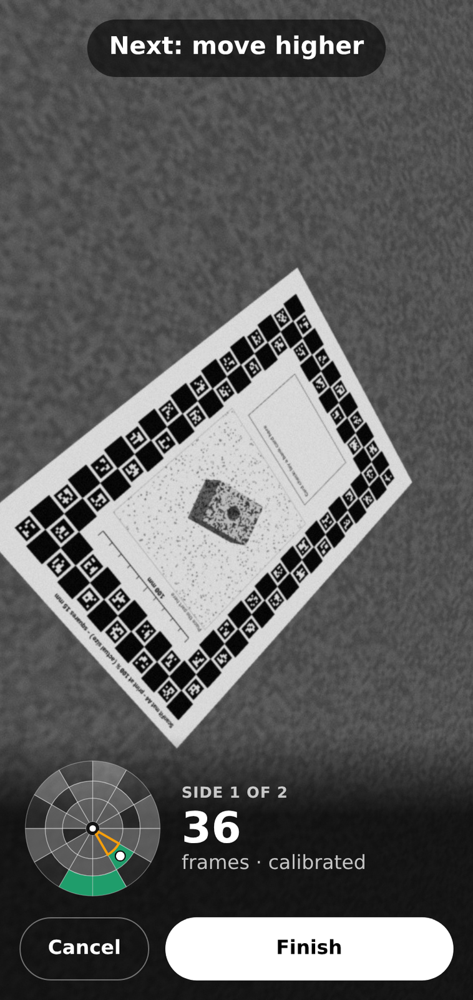

# Scanning guide

A good scan takes 3–5 minutes of filming. The app keeps only useful frames and
tells you what to do next.

## Before you start

- **Light**: bright, even room light. Avoid strong sun patches and hard shadows.
- **Mat**: flat, not creased. Nothing else on it.
- **Part**: in the clear centre of the mat (about 11 × 11 cm), not on the
  printed ring. Clean off dust and fingerprints.
- **Dark or black parts**: plan to use the **Light** button (the phone's torch).
- **Shiny parts**: a light dusting of matt spray (or dry shampoo) helps a lot.

## Step 1: calibration (the whole mat)

1. Tap **Start scanning** on the home page.
2. Hold the phone 20–50 cm away so the **whole mat** is in view.
3. Move slowly around the mat, at different heights. The app needs 12 good views
   from different directions. The counter shows the progress.

The app now knows the camera's lens and locks the colour, so the photos match.

## Step 2: around the part

1. Circle the part slowly: once low (almost level with the table), once at mid
   height, once from high above.
2. Go closer for detail. The mat may leave the picture now; that is fine.
3. Watch the **dome**: it shows which directions are filmed. The outlined cell
   is the next one to fill.
4. Follow the hints: "Move slower", "Too dark: add light", "Get closer",
   "Next: move left and higher".
5. When the dome is full, the app says so. Tap **Finish**, or add close-ups of
   holes and small details first.

## Step 3: the other side

A normal scan films the part twice. After **Finish**, the app sends side 1 and
asks you to turn the part over: put it on another face, back in the clear
centre, and tap **Film side 2**. Repeat steps 1 and 2. The PC joins the two
halves, so the underside is in the 3D copy too.

**Quick scan.** For a part you cannot turn over, tap **Quick scan** on the
home page (or **Quick scan: stop here** after side 1). Only one side is
filmed, so parts of the object may be missing: the result says "Quick scan",
and its overall size is marked "may be incomplete" and gets no grade.

## Tips

- **Move slowly.** Blurry frames are thrown away.
- **Torch for close-ups.** It lights the inside of holes and dark faces.
- **Holes:** film them square-on from a few directions, close enough that the
  hole fills a good part of the picture.
- **Do not move the part** during one side's filming.
- **Keep the mat in the same place** between calibration and close-ups.

## While the PC works

The result page shows the progress live: cameras, points, then the shape
forming. A side takes about 25 minutes on a modest laptop (a normal two-sided scan,
about 50). You can close the
page and come back; the result is kept for 24 hours.

Next: [reading the results](reading-results.md).
